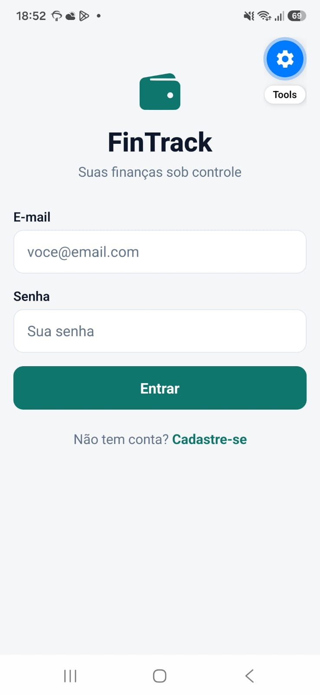
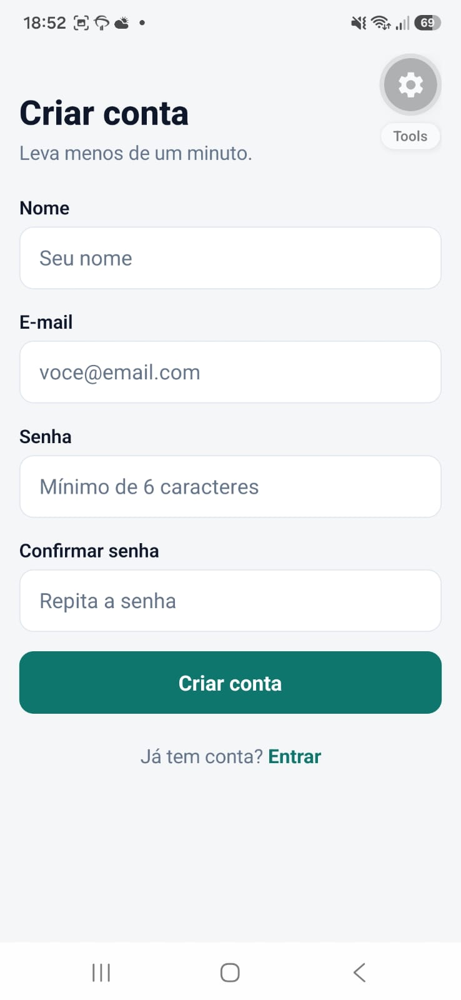
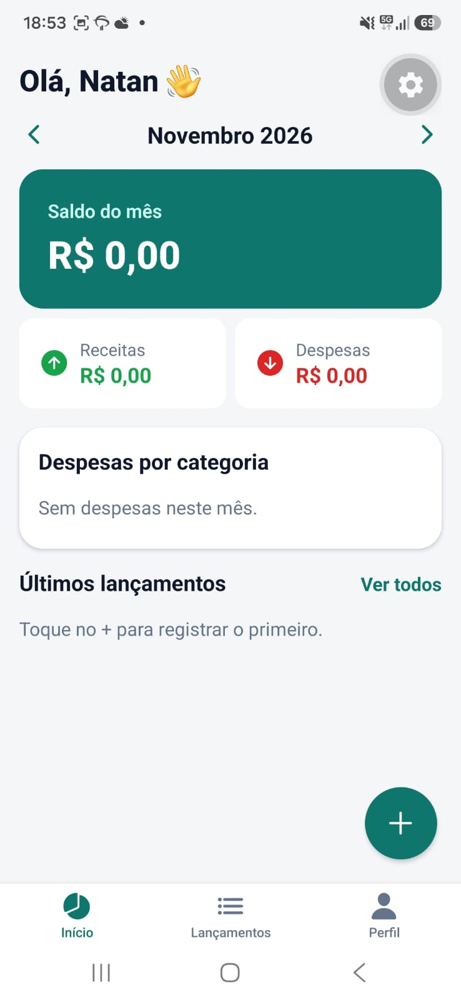
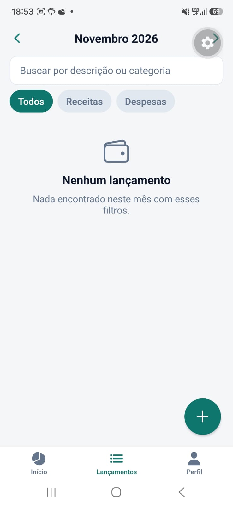
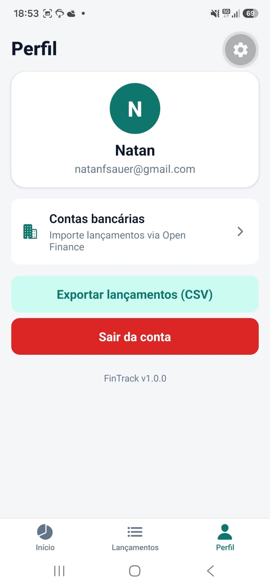
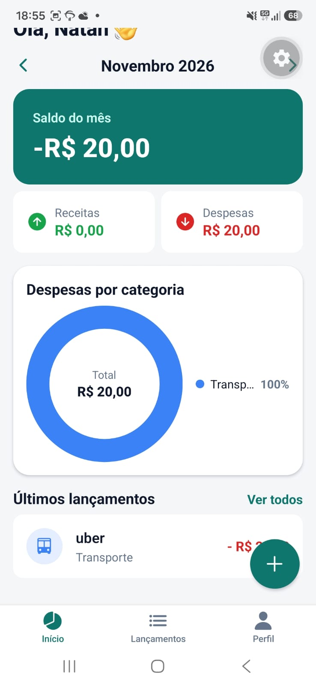
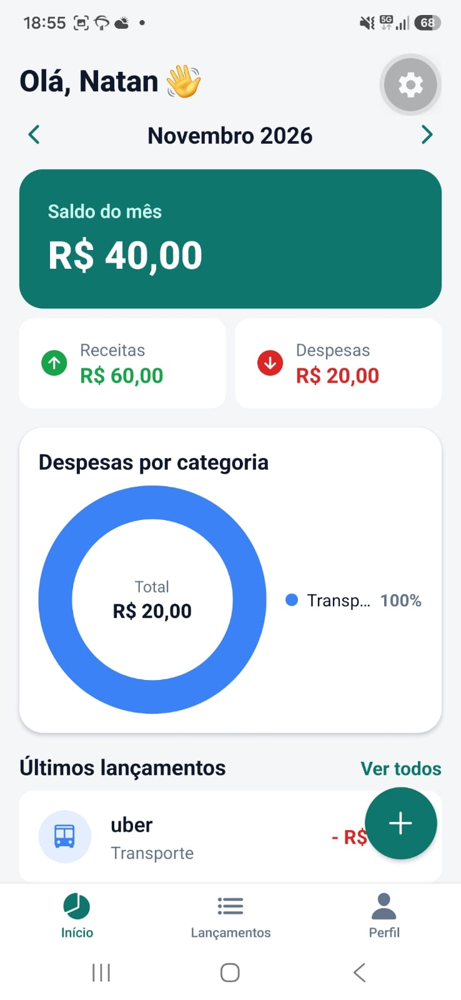
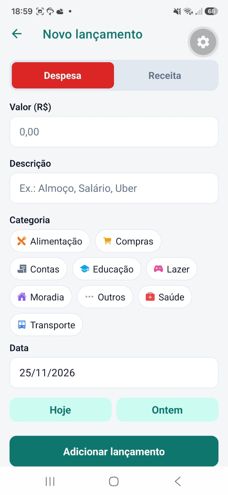
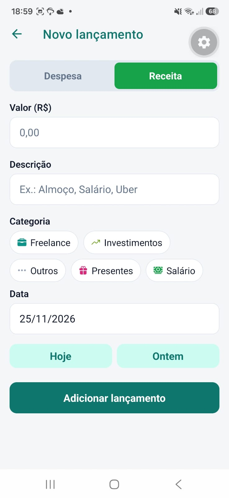

# FinTrack

Aplicativo mobile de finanças pessoais: registre receitas e despesas, **importe
lançamentos direto do seu banco via Open Finance** e acompanhe para onde o dinheiro
está indo.

Projeto 1 de 5 da disciplina **Programação para Dispositivos Móveis** (IESB),
desenvolvido por **Natan Forte Sauer** a partir do guia do Prof. Me. Bruno Assunção Dias.

## Capturas de tela

App rodando no celular (Android) pelo Expo Go.

| Login | Cadastro | Início |
| :---: | :---: | :---: |
|  |  |  |

| Lançamentos (vazio) | Perfil | Início com despesa |
| :---: | :---: | :---: |
|  |  |  |

| Início com lançamentos | Novo lançamento (despesa) | Novo lançamento (receita) |
| :---: | :---: | :---: |
|  |  |  |

## Funcionalidades

- Cadastro, login e sessão persistente (Supabase Auth)
- Lançamentos de receitas e despesas: criar, editar e excluir
- **Open Finance (modo simulado):** conexão, importação, sincronização sem duplicar e
  desconexão com um extrato fictício. A integração real com o Pluggy está no código
  (Edge Functions), mas não foi publicada por falta de credenciais
- Painel mensal com saldo, receitas, despesas e gráfico de rosca por categoria
- Lista agrupada por dia, com busca e filtro por tipo
- Exportação dos lançamentos em CSV
- Dados isolados por usuário com Row Level Security

## Tecnologias

React Native · Expo (SDK 58) · Expo Router · TypeScript · Supabase (Auth, Postgres, RLS,
Edge Functions) · Pluggy (agregador Open Finance) · TanStack Query · React Hook Form ·
Zod · react-native-svg · Jest

## Como executar (Windows)

Os scripts `.bat` na raiz fazem tudo na ordem:

| Script | O que faz |
| --- | --- |
| `1-instalar-dependencias.bat` | Instala o Expo SDK 58 e todas as bibliotecas compatíveis |
| `2-configurar-banco.bat` | Copia `supabase/setup-completo.sql` e abre o SQL Editor do Supabase |
| `3-verificar-codigo.bat` | `npm run typecheck` + `npm test` (51 testes) |
| `4-iniciar-app.bat` | `npx expo start -c` (QR Code para o Expo Go) |
| `4b-iniciar-app-tunnel.bat` | Mesmo que o anterior, com `--tunnel` (redes de faculdade) |
| `5-publicar-funcoes-open-finance.bat` | Opcional: segredos do Pluggy + deploy das 3 Edge Functions |

### Manualmente

1. `npm install` (ou rode o `1-instalar-dependencias.bat` na primeira vez)
2. No Supabase, execute `supabase/setup-completo.sql` no SQL Editor
   (equivale a `schema.sql` + `open-finance.sql`) e desligue *Confirm email*.
3. Copie `.env.example` para `.env` e preencha a URL e a chave pública.
4. Open Finance (opcional): crie uma aplicação em
   [dashboard.pluggy.ai](https://dashboard.pluggy.ai) e publique as funções:

   ```
   npx supabase login
   npx supabase link --project-ref SEU-PROJECT-REF
   npx supabase secrets set PLUGGY_CLIENT_ID=... PLUGGY_CLIENT_SECRET=...
   npx supabase functions deploy bank-connect-token --use-api --no-verify-jwt
   npx supabase functions deploy bank-sync --use-api --no-verify-jwt
   npx supabase functions deploy bank-disconnect --use-api --no-verify-jwt
   ```
5. `npx expo start -c` e abra no Expo Go.

Banco de teste do Pluggy: usuário `user-ok`, senha `password-ok`, MFA `123456`.

## Modo simulado do Open Finance

Por padrão o app roda com `EXPO_PUBLIC_OPEN_FINANCE_MODE=simulado`: em Perfil → Contas
bancárias → Conectar um banco aparece o **Pluggy Bank (simulado)**. Ao autorizar, o app gera
um extrato fictício (conta corrente e cartão) no mesmo formato da API do Pluggy e o importa
com as **mesmas regras puras** da Edge Function `bank-sync` (`mapTransaction`, categorias,
fatura do cartão ignorada, pendentes e moeda estrangeira ignoradas). A gravação usa as
mesmas tabelas, o mesmo RLS e a mesma chave única, então sincronizar de novo não duplica
e desconectar apaga os lançamentos importados. Nenhum banco real é acessado.

Para usar o Pluggy de verdade: crie uma aplicação no dashboard.pluggy.ai, rode o
`5-publicar-funcoes-open-finance.bat` e troque para `EXPO_PUBLIC_OPEN_FINANCE_MODE=pluggy`.

## Como o Open Finance real funciona

```
app  ->  bank-connect-token  ->  Pluggy (token de 30 min)
app  ->  widget do Pluggy    ->  consentimento no banco
app  ->  bank-sync           ->  Pluggy -> regras puras -> tabela transactions
```

As credenciais do Pluggy ficam só no servidor. A função confere que a conexão pertence
ao usuário logado antes de importar, e a importação é idempotente (chave única
`user_id + external_id`).

## Scripts npm

| Comando | O que faz |
| --- | --- |
| `npm start` | Inicia o servidor do Expo |
| `npm test` | Executa os testes unitários |
| `npm run typecheck` | Verifica os tipos com o TSC |
| `npm run format` | Formata o código (Prettier) |

## Correções em relação ao guia

O arquivo `RELATORIO-CORRECOES-FinTrack.docx` descreve cada problema encontrado ao
seguir o guia, o prompt usado com a IA, a resposta e a solução aplicada.

## Autor

Natan Forte Sauer · [GitHub](https://github.com/natansauer)
